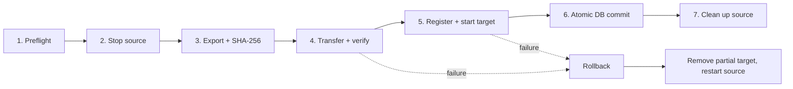

<div align="center">

# TGVPANEL

**Unified virtualization control panel for QEMU/KVM virtual machines and LXC containers**

Multi-node · Secure by default · Pure Node.js + TypeScript


-003b57?logo=sqlite&logoColor=white)


[Quick Start](#quick-start) ·
[Multi-Node Setup Guide](docs/MULTINODE_SETUP.md) ·
[Features](#features) ·
[Architecture](#architecture) ·
[Node Agent](#remote-node-agent) ·
[Migration](#vps-migration-model) ·
[Testing](#testing)

</div>

---

## Overview

TGVPANEL is a single platform for managing both virtual machines and containers, with multi-node support built in.

- **One panel, two hypervisors.** KVM and LXC instances share the same UI, API, storage, networking, backup and monitoring layers.
- **Multi-node.** Manage remote compute nodes through a standalone agent with HMAC-signed requests and optional mutual TLS.
- **Honest by design.** Migration is offline and checksum-verified. Live (CRIU) migration is intentionally not claimed.

## Features

| Area | Highlights |
|---|---|
| **Virtualization** | KVM and LXC adapters behind one `VirtualizationManager`; native `lxc-*` lifecycle; cgroup v1/v2 resource limits |
| **Consoles** | Interactive container PTY via `node-pty` + `lxc-attach`; xterm.js served locally (no CDN); opt-in, audited admin node shell |
| **Storage** | Pools (RAW, QCOW2, directory, LVM, ZFS, Btrfs), ISO library, LXC OS template catalog |
| **Networking** | Bridges, NAT, IPv4/IPv6 pools, port forwards, bandwidth limits, iptables changes with rollback |
| **Backups** | KVM QCOW2 and LXC snapshots, SHA-256 verified `tar.gz` backups, scheduled backups |
| **Migration** | 7-stage offline snapshot-transfer with automatic rollback ([details](#vps-migration-model)) |
| **Monitoring** | Live and historical node/VPS metrics, alert rules, notifications, webhooks |
| **Multi-node** | Node registry, circuit breakers, health sync, live API key rotation |
| **API** | Versioned REST API at `/api/v1/*` with scoped personal access tokens |
| **UI** | 23-section admin panel plus user portal, dark/light themes |

### Security

| Control | Implementation |
|---|---|
| Secrets at rest | `.tgvpanel-secret` (mode `0600`); remote node API keys encrypted with AES-256-GCM |
| Credentials | `bcrypt` passwords; PATs stored as SHA-256 hashes |
| Two-factor auth | RFC 6238 TOTP |
| Web protection | CSRF tokens, rate limiting, input validators |
| Access control | RBAC: `admin`, `subadmin`, `operator`, `user`, `readonly`, with per-user ownership isolation and VPS sharing |
| Node transport | HTTPS, optional mTLS, per-request HMAC-SHA256 with timestamp & nonce replay protection |
| Command execution | Strict binary allowlist, `execFile` only, `shell: false` |
| Filesystem access | Container rootfs I/O confined by `realpath` (path-traversal jail) |
| Auditing | Audit log for sensitive and administrative actions |

## Requirements

| Component | Needed for |
|---|---|
| Linux: Ubuntu, Debian, AlmaLinux or Rocky | Host OS supported by the installer |
| Node.js 20+ and npm | Panel and agent |
| C/C++ toolchain and Node headers | Building native addons (`node-pty`, SQLite driver) |
| `/dev/kvm`, `qemu-system-x86_64`, `qemu-img` | KVM virtual machines |
| `lxc-*` tools | LXC containers |
| cgroups v2 (v1 also handled) | Resource limits and telemetry |

You only need the hypervisor pieces for the modes you plan to use. The installer detects what is present.

## Quick Start

### Option 1: Automated installer (recommended)

```bash
git clone https://github.com/ShadowGamerIND37/TGVPANEL.git
cd TGVPANEL
sudo bash scripts/install.sh
```

The installer will:

1. Detect `/dev/kvm`, QEMU, `qemu-img`, `lxc-*`, cgroups v2 and networking tools.
2. Ask you to choose a mode: **Unified (KVM + LXC)**, **KVM only**, **LXC only**, or **Standalone remote node agent**.
3. Build the TypeScript sources.
4. Create `.tgvpanel-secret` (`0600`).
5. Back up `data/tgvpanel.db`, then run migrations (`v001`..`v009`).
6. Write systemd service units (`tgvpanel.service` / `tgvpanel-node-agent.service`).

To upgrade later, run `sudo bash scripts/update.sh` (capability detection and DB backup included).

### Option 2: Manual setup

```bash
npm install            # see note below if building offline
npm run build          # compile src/**/*.ts -> lib/**/*.js
npm run migrate        # back up data/tgvpanel.db, apply migrations v001..v009
npm start              # panel on 0.0.0.0:8080
```

Change the port with `PORT=9090 npm start`. See `.env.example` for the available settings.

> **Offline builds:** if Node headers live in `/usr/local/include/node`, install with
> `npm_config_nodedir=/usr/local npm install`.

### Available npm scripts

| Command | Description |
|---|---|
| `npm run build` | Compile TypeScript to `lib/` |
| `npm run migrate` | Back up the database and apply pending migrations |
| `npm start` | Start the panel |
| `npm run start:agent` | Start the standalone node agent |
| `npm run import:hvm -- <path>` | Import a legacy database |
| `npm test` | Run all 20 end-to-end acceptance suites |

## Importing a legacy database

```bash
npm run import:hvm -- /path/to/legacy.db
```

- Creates a `VACUUM INTO` backup of `data/tgvpanel.db` first.
- Resolves colliding usernames and emails safely.
- Imports legacy `pbkdf2:sha256` and `scrypt` password hashes and upgrades them to `bcrypt` on the user's next login.
- Re-encrypts remote node API keys with AES-256-GCM.
- Imports LXC containers, port forwards, snapshots, backups, notifications and API keys.

## Remote node agent

> **Full step-by-step guide:** See [**`docs/MULTINODE_SETUP.md`**](docs/MULTINODE_SETUP.md) for complete Single-Node & Multi-Node setup instructions (firewall rules, NTP sync, TLS / self-signed / Let's Encrypt / mTLS / WireGuard, systemd service, storage & networking setup, cross-node migration, live key rotation, and troubleshooting).

Run the agent on any compute host you want the panel to manage:

```bash
TGVPANEL_NODE_ID="2" \
TGVPANEL_AGENT_PORT=8443 \
TGVPANEL_NODE_API_KEY="tgv_node_..." \
TGVPANEL_NODE_HMAC_SECRET="..." \
npm run start:agent
```

| Variable | Purpose |
|---|---|
| `TGVPANEL_NODE_ID` | Node ID assigned by **Admin → Nodes** |
| `TGVPANEL_AGENT_PORT` | Listening port (example: `8443` or `5055`) |
| `TGVPANEL_NODE_API_KEY` | Per-node API key (stored hashed) |
| `TGVPANEL_NODE_HMAC_SECRET` | Shared secret for request signing |
| `TGVPANEL_ALLOWED_CONTROLLER_IPS` | Optional comma-separated Controller IP allowlist |
| `TGVPANEL_NODE_MTLS` | Set to `true` to require mutual TLS |

Register the node under **Admin → Nodes** to obtain bootstrap credentials, paste them into `/opt/tgvpanel/.env` on the remote host, start `tgvpanel-node-agent.service`, and click **Check Health**. API keys can be rotated live without restarting the agent.

## VPS migration model

TGVPANEL uses **offline verified snapshot-transfer migration** (`strategy = 'offline_snapshot_transfer'`):



1. **Preflight:** check source and target health, LXC support and free storage.
2. **Stop:** gracefully stop the container on the source for filesystem consistency.
3. **Export:** archive rootfs and config as `tar.gz` while streaming a SHA-256 digest.
4. **Transfer:** authenticated stream to the target, SHA-256 verified before unpacking.
5. **Register:** create the target container, apply resources and network config, verify startup.
6. **Commit:** atomic SQLite ownership change (`lxc_instances`, `instances`, `vps_migrations`).
7. **Clean up:** remove the source only after the target is verified.

Any failure before the commit removes partial target artifacts and restarts the source container.

> CRIU memory-page live migration is intentionally not claimed.

## Architecture

```
TGVPANEL/
├── app.js                  # Express + HTTP + WebSocket entrypoint
├── licenses.js             # Free Edition license module
├── data/                   # tgvpanel.db (SQLite, WAL) and backups/
├── src/
│   ├── context.ts          # Runtime bootstrap, authenticated WS multiplexer
│   ├── security/           # crypto-vault (.tgvpanel-secret, AES-GCM, TOTP, CSRF), RBAC middleware
│   ├── db/                 # SQLite wrapper, migrations v001..v009, legacy DB importer, CLIs
│   ├── node-agent/         # Standalone and local agent (auth, command runner, containers,
│   │                       #   consoles, snapshots, transfers, health and host stats)
│   ├── services/
│   │   ├── virtualization/ # KVM + LXC adapters, instance manager
│   │   ├── nodes/          # Multi-node client, circuit breakers, key rotation
│   │   ├── storage/        # Pools, ISOs, template catalog
│   │   ├── network/        # Bridges, NAT, IP pools, port forwards, firewall rollback
│   │   ├── backup/         # Unified snapshots and verified backups
│   │   ├── migration/      # Offline snapshot-transfer migration
│   │   └── monitoring/     # Metrics, alerts, notifications, webhooks
│   └── api/
│       ├── v1/router.ts    # REST API (/api/v1/*)
│       └── web-routes.ts   # Admin (23 sections) and user EJS routes
├── views/                  # EJS templates (dark/light, local xterm.js)
├── public/                 # CSS, tgvpanel-v3.js client helper, /vendor/xterm/
├── scripts/                # install.sh, update.sh
├── docs/                   # Multi-node setup guide, source audit, migration checklist, PostgreSQL 15+ guide
└── tests/run-all.js        # 20-suite integration and security runner
```

<details>
<summary><strong>Per-file reference for <code>src/security/</code> and <code>src/node-agent/</code></strong></summary>

| File | Responsibility |
|---|---|
| `security/crypto-vault.ts` | `.tgvpanel-secret`, AES-256-GCM, SHA-256 PATs, HMAC, TOTP, CSRF |
| `security/middleware.ts` | RBAC, CSRF, rate limiting, validators |
| `node-agent/agent.ts` | HTTP/HTTPS/mTLS + WebSocket server, `LocalNodeRuntime` |
| `node-agent/authentication.ts` | API key hash, HMAC signature, timestamp and nonce replay guard |
| `node-agent/command-runner.ts` | Binary allowlist, `execFile` only, `shell: false` |
| `node-agent/health.ts`, `host-stats.ts` | `/dev/kvm`, QEMU, LXC, cgroup v2 and `/proc` telemetry |
| `node-agent/container-manager.ts` | `lxc-*` lifecycle, cgroup limits, realpath-confined rootfs I/O |
| `node-agent/container-console.ts` | `node-pty` + `lxc-attach` container terminal |
| `node-agent/shell-manager.ts` | Diagnostic presets and opt-in audited admin shell |
| `node-agent/snapshot-manager.ts` | LXC snapshots and SHA-256 verified backups |
| `node-agent/transfer-manager.ts` | Checksum-verified archive export/import |

</details>

## Testing

```bash
npm test
```

Runs 20 end-to-end suites from `tests/run-all.js` against an isolated temporary clone of `data/tgvpanel.db`, so your real data is never touched.

| Coverage |
|---|
| Migrations (`v001`..`v009`) & automatic legacy DB / secret-vault file migration |
| AES-256-GCM tamper defense (`.tgvpanel-secret`) |
| Legacy import and login rehash |
| CSRF and PAT scopes |
| TOTP 2FA |
| RBAC, ownership isolation, VPS sharing |
| Agent HMAC and replay rejection |
| Linux `/proc` telemetry |
| Path-traversal jail and command allowlist |
| Storage, templates, networking, ports, firewall |
| SHA-256 backups, monitoring, impersonation |
| All 23 admin and user views plus `node-pty` WebSocket shell |
| End-to-end LXC creation, snapshots, backups, 7-stage offline migration, KVM nesting, DNS/Netplan, loop disk quotas & cgroup v2 delegation |

## Contributing

Issues and pull requests are welcome. Before opening a PR, run `npm run build && npm test`.

## License

MIT © ShadowGamerIND
