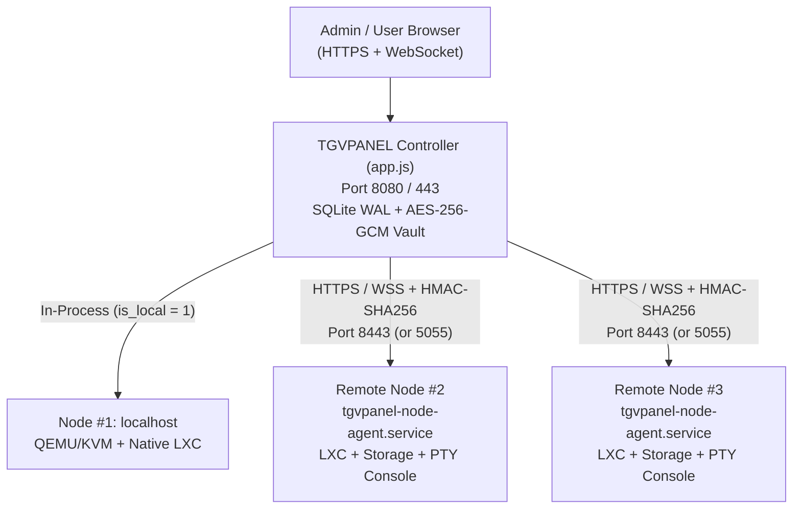

# TGVPANEL — Node & Multi-Node Setup Guide

This guide explains how to set up both a **single-server compute node** (`localhost`) and a **multi-node cluster** connecting multiple remote Linux servers to one central **TGVPANEL Controller**.

---

## Table of Contents

1. [Architecture Overview](#1-architecture-overview)
2. [System, Network & Firewall Prerequisites](#2-system-network--firewall-prerequisites)
3. [Single-Node Setup (All-in-One Controller + Compute)](#3-single-node-setup-all-in-one-controller--compute)
4. [Multi-Node Setup — Adding a Remote Compute Node (Step-by-Step)](#4-multi-node-setup--adding-a-remote-compute-node-step-by-step)
   - [Step 1: Register the Remote Node on the Controller](#step-1-register-the-remote-node-on-the-controller)
   - [Step 2: Install the Standalone Node Agent on the Remote Server](#step-2-install-the-standalone-node-agent-on-the-remote-server)
   - [Step 3: Configure TLS / Transport Encryption](#step-3-configure-tls--transport-encryption)
   - [Step 4: Configure `.env` on the Remote Node](#step-4-configure-env-on-the-remote-node)
   - [Step 5: Start & Enable the Systemd Service](#step-5-start--enable-the-systemd-service)
   - [Step 6: Verify Health & Sync Capabilities](#step-6-verify-health--sync-capabilities)
5. [Post-Setup: Storage Pools, Networking & Deploying to Remote Nodes](#5-post-setup-storage-pools-networking--deploying-to-remote-nodes)
6. [Cross-Node VPS Migration](#6-cross-node-vps-migration)
7. [Day-2 Operations (Key Rotation, Maintenance Mode, Updates & Removal)](#7-day-2-operations-key-rotation-maintenance-mode-updates--removal)
8. [Node Agent Environment Variable Reference](#8-node-agent-environment-variable-reference)
9. [Troubleshooting](#9-troubleshooting)

---

## 1. Architecture Overview

TGVPANEL uses a **Controller + Compute Node Agent** architecture:



### Key Design Points

- **Built-in Local Node (`Node #1 — localhost`)**: Every TGVPANEL installation automatically registers `localhost` (`id = 1`, `is_local = 1`) using an in-process `LocalNodeRuntime`. You **do not** need to run a separate agent daemon on the controller machine itself.
- **Standalone Remote Node Agent (`Node #2+`)**: Remote servers run `lib/node-agent/agent.js` (`tgvpanel-node-agent.service`) — a lightweight Node.js daemon with **no SQLite database** and **no web UI**.
- **Engine Support by Node Type**:
  - **`localhost` (Controller Node)**: Supports both **QEMU/KVM Virtual Machines** and **LXC Containers**.
  - **Remote Node Agents**: Support full **LXC Container** lifecycle (provisioning from templates or custom archives, sparse `ext4` loop disk quotas, cgroup v2 CPU/RAM/cpuset enforcement, `/dev/kvm` passthrough inside LXC, rootfs file manager, real-time `xterm.js` PTY console over WebSockets, snapshots, SHA-256 backups, host telemetry, diagnostic presets, opt-in audited host PTY shell, and 7-stage cross-node offline migration).
- **Per-Request Replay-Protected Security**:
  - Every REST call and WebSocket upgrade from Controller → Node Agent carries:
    - `X-HKVM-Node-Key`: Per-node API key (`tgv_node_...`), verified against its SHA-256 hash using constant-time comparison.
    - `X-HKVM-Timestamp`, `X-HKVM-Nonce`, `X-HKVM-Signature`: HMAC-SHA256 signature over `METHOD + PATH + TIMESTAMP + NONCE + SHA256(BODY)`.
  - Requests older than **300 seconds (5 minutes)** or reusing any seen nonce within 10 minutes are rejected (`401` / `409`).
- **Automatic Circuit Breakers**: After **3 consecutive connection failures**, the controller marks a remote node `offline` (`circuit_state = open`) for a **30-second cooldown** before probing again (`half-open`), preventing a down host from stalling the panel UI.

---

## 2. System, Network & Firewall Prerequisites

### Supported Linux Distributions (Controller & Remote Nodes)
- **Ubuntu** 22.04 LTS / 24.04 LTS *(Recommended)*
- **Debian** 12 (Bookworm) / 13 (Trixie)
- **AlmaLinux / Rocky Linux** 9

### Required Software on Remote Compute Nodes
- **Root access** (or passwordless `sudo` for the service user) so the agent can run allowlisted `lxc-*`, `ip`, `iptables`, `losetup`, `mount`, `lxcfs`, and cgroup v2 operations.
- **Node.js 20 LTS or 22 LTS** + `npm` + C/C++ build tools (`build-essential`, `python3`, `make`, `g++`) to compile `node-pty`.
- **Linux Cgroups v2** unified hierarchy (`/sys/fs/cgroup/cgroup.controllers`) — enabled by default on Ubuntu 22.04+, Debian 12+, and EL9.
- **LXC userspace tools**: `lxc`, `lxc-templates`, `lxcfs`, `uidmap`, `bridge-utils`, `dnsmasq-base`, `iproute2`, `iptables`.

### Mandatory: Synchronized System Clocks (NTP)
Because HMAC request signatures enforce a strict **±300 second** timestamp window, both the **Controller** and **every Remote Node** must have NTP enabled:

```bash
sudo timedatectl set-ntp true
timedatectl status
```
Verify `System clock synchronized: yes` on both servers before connecting them.

### Firewall Ports

| Server | Port | Protocol | Source | Purpose |
|---|---|---|---|---|
| **Controller** | `8080` (or `80`/`443` via reverse proxy) | TCP | Admins / Users | TGVPANEL Web UI, REST API & Browser WebSockets |
| **Remote Node** | `8443` (or `5055`) | TCP | **Controller IP only** | Node Agent REST API (`/api/v1/*`) & PTY WebSockets (`/ws/*`) |
| **Remote Node** | Custom forwarded ports (e.g. `10000–60000`) | TCP/UDP | Public / Users | Guest NAT port forwards (`Admin → Port Forwards`) |

Lock the Node Agent port on each **Remote Node** so **only** your Controller IP (`<CONTROLLER_IP>`) can reach it:

```bash
# UFW (Ubuntu / Debian)
sudo ufw allow from <CONTROLLER_IP> to any port 8443 proto tcp comment 'TGVPANEL Controller'

# Firewalld (AlmaLinux / Rocky 9)
sudo firewall-cmd --permanent --add-rich-rule='rule family="ipv4" source address="<CONTROLLER_IP>" port port="8443" protocol="tcp" accept'
sudo firewall-cmd --reload
```

---

## 3. Single-Node Setup (All-in-One Controller + Compute)

If you are running TGVPANEL on a **single dedicated server or VPS**, both the web panel and local compute (`localhost`, Node `#1`) are configured in one command:

```bash
git clone https://github.com/ShadowGamerIND37/TGVPANEL.git /opt/tgvpanel
cd /opt/tgvpanel

# Install Node.js 20 LTS first if not already installed:
# curl -fsSL https://deb.nodesource.com/setup_20.x | sudo -E bash - && sudo apt-get install -y nodejs

sudo bash scripts/install.sh
```

Select **`1) Unified Panel + KVM + LXC (Recommended)`** (or `2` for KVM-only / `3` for LXC-only).

Once started (`sudo systemctl status tgvpanel`), open `http://<SERVER_IP>:8080`, log in, and go to **Admin → Nodes** (`/admin/nodes`). You will see **`#1 localhost` (`LOCAL`)** online with its detected CPU, RAM, Disk, KVM, LXC, and Cgroup v2 capabilities.

---

## 4. Multi-Node Setup — Adding a Remote Compute Node (Step-by-Step)

> **Fastest Interactive Setup (`menu.sh` Option 2):**
> On any fresh remote server, you can automate Steps 2–6 below with one command:
> ```bash
> curl -fsSL https://raw.githubusercontent.com/ShadowGamerIND37/TGVPANEL/main/menu.sh -o menu.sh && sudo bash menu.sh
> ```
> Choose **`2) Auto Configure Node`** — it installs Git, Node.js 20+, LXC/LXCFS, clones TGVPANEL, asks for your Node credentials (or auto-registers via Controller URL + Admin API token), generates TLS certificates, configures UFW/Firewalld, and keeps `tgvpanel-node-agent` online **24/7**!

Below is the complete step-by-step reference for what happens under the hood (or if configuring manually).

---

### Step 1: Register the Remote Node on the Controller

1. Log in to your **TGVPANEL Controller** as an administrator.
2. Navigate to **Admin → Nodes** (`/admin/nodes`).
3. Under **Register Remote Node Agent**, fill in:
   - **Node Name**: Short identifier, e.g. `eu-fra-node-02`
   - **Hostname**: Server FQDN or hostname, e.g. `fra02.example.com`
   - **IPv4 Address**: Public or private WireGuard IP of the remote server, e.g. `203.0.113.10`
   - **Agent URL**:
     - Public network (HTTPS): `https://203.0.113.10:8443` *(or `https://fra02.example.com:8443`)*
     - Private WireGuard / internal VLAN (HTTP): `http://10.10.0.2:5055`
   - **Location**: Datacenter label, e.g. `Frankfurt, DE`
   - **Verify TLS Cert**:
     - Leave **checked** if using Let's Encrypt / valid CA certificate (or plain HTTP over WireGuard).
     - **Uncheck** if using a self-signed certificate generated via `openssl` (Step 3A below).
4. Click **Register Node**.
5. **Copy the Bootstrap Credentials** displayed on screen right away (they are shown once at creation time):

```ini
# Remote Node Bootstrap Credentials — paste into /opt/tgvpanel/.env on the remote node:
TGVPANEL_NODE_ID=2
TGVPANEL_AGENT_HOST=0.0.0.0
TGVPANEL_AGENT_PORT=8443
TGVPANEL_NODE_API_KEY=tgv_node_xxxxxxxxxxxxxxxxxxxxxxxxxxxxxxxxxxxxxxxx
TGVPANEL_NODE_HMAC_SECRET=xxxxxxxxxxxxxxxxxxxxxxxxxxxxxxxxxxxxxxxxxxxxxxxxxxxxxxxxxxxxxxxx
```

<details>
<summary><strong>Optional: Register a node via REST API (Ansible / Terraform automation)</strong></summary>

```bash
curl -X POST "https://panel.example.com/api/v1/nodes" \
  -H "Authorization: Bearer <YOUR_ADMIN_PAT_WITH_NODES_WRITE>" \
  -H "Content-Type: application/json" \
  -d '{
    "name": "eu-fra-node-02",
    "hostname": "fra02.example.com",
    "ipAddress": "203.0.113.10",
    "url": "https://203.0.113.10:8443",
    "location": "Frankfurt, DE",
    "verifySsl": false
  }'
```
</details>

---

### Step 2: Install the Standalone Node Agent on the Remote Server

SSH into the **remote server** as `root`:

#### Ensure Node.js 20+ is installed (Ubuntu / Debian example)
```bash
curl -fsSL https://deb.nodesource.com/setup_20.x | sudo -E bash -
sudo apt-get install -y nodejs git
node -v   # Should print v20.x or v22.x
```

#### Clone TGVPANEL and run Installer Mode 4 (`Standalone Remote Node Agent`)
```bash
git clone https://github.com/ShadowGamerIND37/TGVPANEL.git /opt/tgvpanel
cd /opt/tgvpanel

sudo TGVPANEL_INSTALL_MODE=agent AGENT_PORT=8443 TGVPANEL_NONINTERACTIVE=1 bash scripts/install.sh
```
*(Or run `sudo bash scripts/install.sh` interactively and choose **`4) Standalone Remote Node Agent`**.)*

What Mode 4 does automatically:
- Installs OS virtualization & networking packages (`lxc`, `lxc-templates`, `uidmap`, `bridge-utils`, `dnsmasq-base`, `iproute2`, `iptables`, `nftables`, `tar`, `openssl`, build tools) plus `lxcfs` if available (`sudo apt-get install -y lxcfs` is also recommended on Ubuntu/Debian).
- Installs Node dependencies and compiles TypeScript (`src/` → `lib/`).
- Skips creating any panel SQLite database or web panel service.
- Installs `/etc/systemd/system/tgvpanel-node-agent.service`.

```bash
# Recommended on Ubuntu/Debian so `free -h`, `top`, and `nproc` inside LXC guests reflect exact container limits:
sudo apt-get install -y lxcfs
```

---

### Step 3: Configure TLS / Transport Encryption

Choose **one** of the four transport options matching how you registered **Agent URL** in Step 1:

#### Option A: Self-Signed HTTPS Certificate *(Fastest for Public IP Nodes)*
Run on the **remote node** (replace `203.0.113.10` with your remote node's IP):

```bash
sudo mkdir -p /etc/tgvpanel/ssl
sudo openssl req -x509 -nodes -newkey rsa:4096 -days 3650 \
  -keyout /etc/tgvpanel/ssl/agent.key \
  -out /etc/tgvpanel/ssl/agent.crt \
  -subj "/CN=tgvpanel-node-agent" \
  -addext "subjectAltName=IP:203.0.113.10"
sudo chmod 600 /etc/tgvpanel/ssl/agent.key
```
*(Make sure **Verify TLS Cert** was unchecked when registering the node in Step 1.)*

#### Option B: Let's Encrypt Certificate *(Valid Domain Name)*
If the remote node has a DNS A-record (e.g. `fra02.example.com`):

```bash
sudo apt-get install -y certbot
sudo certbot certonly --standalone -d fra02.example.com
```
Point `TGVPANEL_AGENT_TLS_CERT=/etc/letsencrypt/live/fra02.example.com/fullchain.pem` and `TGVPANEL_AGENT_TLS_KEY=/etc/letsencrypt/live/fra02.example.com/privkey.pem` in `.env`, and keep **Verify TLS Cert** checked!

#### Option C: Mutual TLS (`mTLS`) *(Maximum Zero-Trust Security)*
Generate an internal CA, sign both a server certificate (for the remote node) and a client certificate (for the controller), and set:
- `TGVPANEL_AGENT_TLS_CERT=/etc/tgvpanel/ssl/agent.crt`
- `TGVPANEL_AGENT_TLS_KEY=/etc/tgvpanel/ssl/agent.key`
- `TGVPANEL_AGENT_TLS_CA=/etc/tgvpanel/ssl/ca.crt`
- `TGVPANEL_NODE_MTLS=true`

#### Option D: Private WireGuard / Private LAN (`http://`)
If the Controller and Remote Node communicate exclusively over an encrypted WireGuard tunnel (e.g. `10.10.0.1` ↔ `10.10.0.2`), you can bind directly to the WireGuard IP (`TGVPANEL_AGENT_HOST=10.10.0.2`, `TGVPANEL_AGENT_PORT=5055`) without extra TLS paths and register `http://10.10.0.2:5055`. HMAC-SHA256 request signing and replay protection remain active on every request.

---

### Step 4: Configure `.env` on the Remote Node

Create `/opt/tgvpanel/.env` on the **remote server** using the bootstrap credentials from Step 1:

```bash
sudo tee /opt/tgvpanel/.env > /dev/null <<'EOF'
NODE_ENV=production

# Bootstrap credentials from Controller -> Admin -> Nodes
TGVPANEL_NODE_ID=2
TGVPANEL_AGENT_HOST=0.0.0.0
TGVPANEL_AGENT_PORT=8443
TGVPANEL_NODE_API_KEY=tgv_node_PASTE_YOUR_API_KEY_HERE
TGVPANEL_NODE_HMAC_SECRET=PASTE_YOUR_HMAC_SECRET_HERE

# Optional: Only accept requests from your Controller IP(s) (comma-separated)
TGVPANEL_ALLOWED_CONTROLLER_IPS=198.51.100.5

# TLS Certificate Paths (omit only if using private WireGuard HTTP)
TGVPANEL_AGENT_TLS_CERT=/etc/tgvpanel/ssl/agent.crt
TGVPANEL_AGENT_TLS_KEY=/etc/tgvpanel/ssl/agent.key
TGVPANEL_NODE_MTLS=false

# Storage Paths on this Compute Node
TGVPANEL_DATA_DIR=/opt/tgvpanel/data
TGVPANEL_LXC_DIR=/var/lib/lxc
TGVPANEL_BACKUP_DIR=/opt/tgvpanel/backups

# Optional: Set to true ONLY if you want to enable interactive root PTY in Admin -> Node Console
TGVPANEL_ENABLE_NODE_SHELL=false
EOF

sudo chmod 600 /opt/tgvpanel/.env
sudo mkdir -p /opt/tgvpanel/data /opt/tgvpanel/backups
```

---

### Step 5: Start & Enable the Systemd Service

Start the agent service and verify it is listening cleanly:

```bash
sudo systemctl daemon-reload
sudo systemctl enable --now tgvpanel-node-agent.service
sudo systemctl status tgvpanel-node-agent.service --no-pager
```

Check live logs:
```bash
sudo journalctl -u tgvpanel-node-agent.service -n 30 --no-pager
```

Expected output:
```text
[TGVPANEL Node Agent v3.0.0] Listening on 0.0.0.0:8443
```

*(For quick foreground testing before using `systemd`, you can also run `cd /opt/tgvpanel && sudo npm run start:agent`.)*

---

### Step 6: Verify Health & Sync Capabilities

1. Return to your **TGVPANEL Controller** browser tab → **Admin → Nodes** (`/admin/nodes`).
2. Find your new node in the table (initially `provisioning`) and click **Check Health**.
3. You should see a green toast: **`Node health & telemetry updated`**.
4. Confirm in the table:
   - **Status**: `online`
   - **Circuit**: `closed`
   - **Capabilities**: `KVM:Yes/No / LXC:Yes` (auto-detected from the remote host)
   - **Hardware**: Exact CPU cores, total RAM (MB), and total Disk (GB) reported from `/proc` and `df` on the remote host!

Your remote compute node is now live and ready for workloads.

---

## 5. Post-Setup: Storage Pools, Networking & Deploying to Remote Nodes

### 1. Register Storage Pools (Optional)
1. Go to **Admin → Storage** (`/admin/storage`).
2. Select your new **Node** in the dropdown, enter a pool name (e.g. `fra02-lxc-nvme`), choose backend type (`dir`, `zfs`, `btrfs`, `lvm`), set path (`/var/lib/lxc`), and save.
3. Click **Sync Real Disk Usage (df)** to pull live capacity from the remote node.

### 2. Networking & IP Pools on Remote Nodes
- **NAT Bridge (`lxcbr0` — Automatic)**: When deploying a container on `lxcbr0` without a static IP, the remote Node Agent automatically ensures `lxcbr0` (`10.0.3.1/24`), IPv4 forwarding, `iptables` MASQUERADE NAT, DNS relay (`BridgeDnsRelay`), and container IP auto-assignment are configured.
- **Static Public / Routed / Bridged IPs (`vmbr0` / `br0`)**:
  1. Configure your Linux bridge (`vmbr0` or `br0`) on the remote host.
  2. Go to **Admin → Networking** (`/admin/networking`), select your remote **Node**, and add your IPv4/IPv6 CIDR allocations and gateway.
- **NAT Port Forwarding**: Go to **Admin → Port Forwards** (`/admin/ports`) to map public ports on the remote node directly to internal LXC container ports (`iptables` DNAT rules are applied directly on that remote node).

### 3. Deploying LXC Containers to a Specific Node
1. Go to **Admin → Create Instance** (`/admin/instances/create`).
2. In the **Target Node** selector, choose your remote node (e.g. `eu-fra-node-02`).
3. Choose any OS from the **LXC Template Catalog** (Ubuntu, Debian, Alpine, Rocky, AlmaLinux, Fedora, Arch, Kali, etc.), set vCPUs, RAM, Swap, Disk Quota (GB), Bridge, and Root Password.
4. Click **Deploy LXC Container**.
5. Once provisioned, click **Manage** or **PTY Console** — TGVPANEL transparently proxies the authenticated `xterm.js` WebSocket stream (`Browser ↔ Controller ↔ Remote Node Agent ↔ node-pty ↔ lxc-attach`) in real time!

### 4. Importing Existing LXC Containers Already on a Host
If a node already had unmanaged containers under `/var/lib/lxc`, go to **Admin → LXC Containers** (`/admin/lxc`) to manage them or sync local containers via **Sync Host Containers**.

---

## 6. Cross-Node VPS Migration

Once you have two or more nodes online (for example `localhost` and `eu-fra-node-02`, or `node-02` and `node-03`), you can move LXC containers between nodes from **Admin → Migrations** (`/admin/migrations`):

1. Select the **Source LXC Container** and **Target Node**.
2. Click **Start Offline Verified Migration**.
3. TGVPANEL executes the **7-Stage Verified Transfer Pipeline**:
   1. **Preflight**: Verifies both source and target nodes are online, support LXC, and have sufficient disk space.
   2. **Stop Source**: Gracefully stops the source container for filesystem consistency.
   3. **Export + SHA-256**: Streams container rootfs + config into a compressed bundle while computing its SHA-256 digest.
   4. **Transfer + Verify**: Uploads the bundle to the target Node Agent and verifies the exact SHA-256 checksum before extraction.
   5. **Import & Boot Check**: Registers container limits/networking on the target node and verifies clean startup.
   6. **Atomic DB Commit**: Updates `lxc_instances` and `instances` to point `node_id` to the target node.
   7. **Source Cleanup**: Destroys the old container on the source node **only after** target commit succeeds.

> If any error occurs prior to Stage 6, TGVPANEL automatically removes partial artifacts on the target node and restarts the original container on the source node with zero data loss.

---

## 7. Day-2 Operations (Key Rotation, Maintenance Mode, Updates & Removal)

### Live Zero-Downtime Credential Rotation
1. Go to **Admin → Nodes** (`/admin/nodes`) and click **Rotate Keys** next to any remote node.
2. The Controller generates a fresh `tgv_node_...` API key + 256-bit HMAC secret, pushes them over an authenticated request to `POST /api/v1/credentials/rotate` on the remote Node Agent, and updates `node_credentials` (AES-256-GCM encrypted) in SQLite.
3. The Remote Node Agent atomically updates its in-memory authenticator **without restarting** and persists the rotated hash + HMAC secret in `/opt/tgvpanel/data/node-agent-credentials.json` (`0600`) so it survives reboots.
4. *(Recommended)* Also update `TGVPANEL_NODE_API_KEY` and `TGVPANEL_NODE_HMAC_SECRET` in `/opt/tgvpanel/.env` with the newly displayed values so `.env` stays in sync if `data/` is ever wiped.

### Putting a Node into Maintenance Mode
To prevent new auto-placements on a node during host kernel maintenance:

```bash
curl -X PATCH "https://panel.example.com/api/v1/nodes/2" \
  -H "Authorization: Bearer <YOUR_ADMIN_PAT>" \
  -H "Content-Type: application/json" \
  -d '{"maintenanceMode": true}'
```
Set `"maintenanceMode": false` when maintenance is complete.

### Updating a Remote Node Agent
Whenever you update the main TGVPANEL Controller, update your remote Node Agents to match:

```bash
cd /opt/tgvpanel
git pull origin main
sudo bash scripts/update.sh
sudo systemctl restart tgvpanel-node-agent.service
```

### Safely Removing a Remote Node
1. Migrate or delete all instances assigned to that node first (TGVPANEL blocks deleting any node that still has assigned instances to prevent orphaned workloads).
2. In **Admin → Nodes**, click **Remove** on the node.
3. On the decommissioned server:
   ```bash
   sudo systemctl disable --now tgvpanel-node-agent.service
   ```

---

## 8. Node Agent Environment Variable Reference

| Variable | Default | Required | Description |
|---|---|---|---|
| `TGVPANEL_NODE_ID` | `remote-node` | Yes | Node ID assigned by **Admin → Nodes** (e.g. `2`) |
| `TGVPANEL_NODE_API_KEY` | — | **Yes** | Per-node secret API key (`tgv_node_...`) |
| `TGVPANEL_NODE_HMAC_SECRET` | — | **Yes** | 64-hex-char shared secret for HMAC-SHA256 signing |
| `TGVPANEL_AGENT_HOST` | `0.0.0.0` | No | Bind IP address (`0.0.0.0` or private WireGuard IP) |
| `TGVPANEL_AGENT_PORT` | `5055` (`8443` via installer) | No | TCP port for Node Agent HTTP/HTTPS & WebSockets |
| `TGVPANEL_ALLOWED_CONTROLLER_IPS` | *(all authenticated)* | No | Comma-separated allowlist of Controller IPs (e.g. `198.51.100.5,10.10.0.1`) |
| `TGVPANEL_AGENT_TLS_CERT` | — | For HTTPS | Path to PEM TLS certificate (`fullchain.pem` / `agent.crt`) |
| `TGVPANEL_AGENT_TLS_KEY` | — | For HTTPS | Path to PEM TLS private key (`privkey.pem` / `agent.key`) |
| `TGVPANEL_AGENT_TLS_CA` | — | For mTLS | Path to CA certificate PEM used to verify client certificates |
| `TGVPANEL_NODE_MTLS` | `false` | No | Set to `true` to enforce Mutual TLS client certificate verification |
| `TGVPANEL_DATA_DIR` | `./data` | No | Directory where rotated `node-agent-credentials.json` (`0600`) is stored |
| `TGVPANEL_LXC_DIR` | `/var/lib/lxc` | No | LXC container root directory on the host |
| `TGVPANEL_BACKUP_DIR` | `./backups` | No | Local staging/archive directory for container snapshots & backups |
| `TGVPANEL_ENABLE_NODE_SHELL` | `false` | No | Set to `true` to allow audited interactive host PTY from Admin → Node Console |

---

## 9. Troubleshooting

### `HMAC signature verification failed or clock skewed` (`HTTP 401`)
- **Cause**: Either `TGVPANEL_NODE_HMAC_SECRET` in `/opt/tgvpanel/.env` does not match the Controller, or the system clock on either server drifted by more than **5 minutes (300s)**.
- **Fix**:
  1. Run `timedatectl status` on **both** Controller and Remote Node and enable NTP (`sudo timedatectl set-ntp true`).
  2. If `TGVPANEL_NODE_HMAC_SECRET` was mis-copied, delete `/opt/tgvpanel/data/node-agent-credentials.json`, re-paste the exact credentials (or re-register the node), and run `sudo systemctl restart tgvpanel-node-agent`.

### `Invalid node API key` (`HTTP 401`)
- **Cause**: `TGVPANEL_NODE_API_KEY` mismatch, or keys were rotated while the agent was offline (`pushedToAgent: false`).
- **Fix**: Copy the latest API Key & HMAC Secret shown after **Rotate Keys**, update `/opt/tgvpanel/.env`, remove stale `/opt/tgvpanel/data/node-agent-credentials.json` if present, and restart `tgvpanel-node-agent.service`.

### `DEPTH_ZERO_SELF_SIGNED_CERT` or `SELF_SIGNED_CERT_IN_CHAIN`
- **Cause**: Remote node uses a self-signed certificate while `verify_ssl` is enabled for that node on the Controller.
- **Fix**: Either uncheck **Verify TLS Cert** when registering the node (or update via `PATCH /api/v1/nodes/<id>` with `{"verifySsl": false}`), or switch to a valid Let's Encrypt certificate.

### `Controller IP <ip> not allowlisted` (`HTTP 403`)
- **Cause**: `TGVPANEL_ALLOWED_CONTROLLER_IPS` is set, and your Controller reached the node from a different egress IP (e.g. IPv6 or NAT gateway IP).
- **Fix**: Add the exact IP shown in the error message to `TGVPANEL_ALLOWED_CONTROLLER_IPS` in `/opt/tgvpanel/.env` and restart `tgvpanel-node-agent`.

### `Circuit breaker OPEN for node #<id>`
- **Cause**: The remote node failed 3 consecutive requests (firewall blocked port, agent stopped, or wrong URL), triggering the 30-second circuit breaker cooldown.
- **Fix**:
  1. On the remote node, verify `sudo systemctl status tgvpanel-node-agent` and `ss -tulpn | grep 8443`.
  2. From the Controller server, test TCP connectivity: `curl -k https://<REMOTE_NODE_IP>:8443/api/v1/health` (an unauthenticated curl should return `{"error":"Missing X-HKVM-Node-Key header"}`, proving network & TLS reachability!).
  3. Wait 30 seconds and click **Check Health** in **Admin → Nodes**.

### WebSocket Container Console (`PTY Console`) Disconnects Immediately Behind Nginx / Cloudflare
- **Cause**: If your **Controller Panel** sits behind Nginx, Caddy, or Cloudflare, WebSocket `Upgrade` headers must be forwarded on `/ws/*`.
- **Fix (Nginx snippet for the Controller Panel)**:
  ```nginx
  location / {
      proxy_pass http://127.0.0.1:8080;
      proxy_http_version 1.1;
      proxy_set_header Upgrade $http_upgrade;
      proxy_set_header Connection "upgrade";
      proxy_set_header Host $host;
      proxy_set_header X-Real-IP $remote_addr;
      proxy_set_header X-Forwarded-For $proxy_add_x_forwarded_for;
      proxy_set_header X-Forwarded-Proto $scheme;
      proxy_read_timeout 3600s;
  }
  ```
  *(Note: Avoid placing Cloudflare's orange-cloud proxy directly in front of the **Remote Node Agent** port `8443`; connect the Controller directly to the Remote Node's IP or DNS-only grey-cloud record so large backup/migration transfers aren't capped by CDN upload limits.)*

### Running a Remote Node Agent Inside Docker / Nested LXC
- **Cause**: Native LXC containers require Cgroup v2 delegation and mount/network namespaces.
- **Fix**: Bare-metal Linux or full KVM VPS hosts are strongly recommended for compute nodes. If running inside an outer container for testing, start the outer container with `--privileged --cgroupns=host -v /lib/modules:/lib/modules:ro`; TGVPANEL's cgroup v2 self-healer automatically evacuates `/sys/fs/cgroup` into `init.scope` and delegates controllers onto `hkvm.lxc`.
